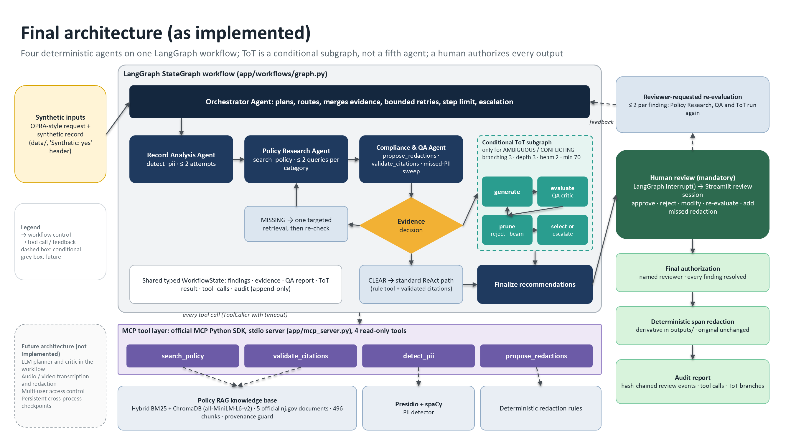

# Agentic Public Records Compliance Assistant

CMU **Building Agentic AI Systems** capstone (Research Assistant track). An agentic prototype that:

- reads a **synthetic** public-records request and record;
- detects potentially sensitive information;
- retrieves the governing **public New Jersey OPRA/GRC policy text**;
- recommends redactions with verifiable citations;
- sends everything to a **human reviewer**, who decides.

> **Prototype only.** The assistant recommends; a named human reviewer authorizes every output. It
> never makes legal disclosure decisions, never modifies original records, and never publishes
> anything. All records are fictional.

**Final evaluation commit:** `7a1a875` (Milestone 6).

**Final deliverables:** [docs/final_capstone/](docs/final_capstone/README.md):
- the report (Markdown / DOCX / PDF);
- the 10-slide deck (PPTX);
- the demo script;
- the evaluation summary;
- the ReAct vs ToT comparison;
- architecture diagrams;
- checkpoint traceability;
- limitations;
- the final verification record.

## Contents

[Overview](#overview) · [Architecture](#architecture) · [Technology stack](#technology-stack) ·
[Prerequisites](#prerequisites) · [Installation](#installation) · [Environment variables](#environment-variables) ·
[Policy sources](#public-policy-sources) · [Synthetic data](#synthetic-test-data) · [Run the application](#run-the-application) ·
[Tests](#run-the-tests) · [Retrieval demo](#reproduce-the-retrieval-demonstration) · [ToT demo](#reproduce-the-multi-agent-and-tot-demonstration) ·
[Human review](#human-review-instructions) · [Evaluation](#evaluation-commands-and-outputs) · [Limitations](#limitations-and-safety-assumptions) ·
[Repository layout](#repository-layout)

## Overview

| Capability | Implementation | Status |
|---|---|---|
| Tool calling through MCP | Official MCP Python SDK server (stdio) with 4 read-only tools | Implemented |
| ReAct-style tool use | Bounded decide → call tool → observe loops | Implemented, **rule-based** (see below) |
| RAG / knowledge | Hybrid BM25 + ChromaDB over 5 official nj.gov documents (496 chunks) | Implemented |
| Multi-agent orchestration | LangGraph: Orchestrator, Record Analysis, Policy Research, Compliance & QA | Implemented |
| Selective Tree of Thought | LangGraph subgraph for ambiguous or conflicting evidence only (branching 3, depth 3, beam 2, min score 70) | Implemented |
| Human feedback | Streamlit reviewer: approve / reject / modify / re-evaluate (≤ 2) / add missed redaction; explicit final authorization | Implemented |
| Redaction and audit | Deterministic span redaction to a separate derivative; hash-chained audit log | Implemented |
| Evaluation and guardrails | 22 scenarios × {ReAct-only, ReAct + ToT}; 16 safety checks; 40 mapped guardrail tests | Implemented |
| Audio / video | — | Deferred |

**All agents are deterministic.** They choose and sequence tool calls with fixed rules; no LLM is
called in the workflow, and no API key is needed. A Claude planner for the single agent exists
(`--planner claude`) but has been tested only with a fake client, never against the live API.

## Architecture



How the workflow runs:

1. **Detect.** The Record Analysis Agent calls `detect_pii`.
2. **Retrieve.** The Policy Research Agent calls `search_policy` for each detected category.
3. **Check.** The Compliance & QA Agent calls `propose_redactions` and `validate_citations`, then
   classifies the evidence as CLEAR, AMBIGUOUS, CONFLICTING or MISSING.
4. **Route.** The Orchestrator sends each case one of three ways:
   - CLEAR → the standard path;
   - MISSING → one targeted retrieval, then escalation;
   - AMBIGUOUS or CONFLICTING → the ToT subgraph (generate → evaluate with the QA critic → prune →
     select or escalate).
5. **Human review.** Every path ends at a LangGraph `interrupt()`.

Sources and Mermaid versions: [docs/final_capstone/architecture/](docs/final_capstone/architecture/README.md).
Design notes: [docs/milestone_4/architecture.md](docs/milestone_4/architecture.md) ·
[docs/milestone_4/tot_design.md](docs/milestone_4/tot_design.md) ·
[docs/milestone_5/review_workflow.md](docs/milestone_5/review_workflow.md).

## Technology stack

| Purpose | Package (pinned in `requirements.txt`) |
|---|---|
| Language | Python (developed and tested on **3.14.7**, Windows 10) |
| Orchestration | LangGraph 1.2.20 |
| Tools | MCP Python SDK 2.3.0 (stdio) |
| Retrieval | ChromaDB 1.5.9 (all-MiniLM-L6-v2 ONNX embeddings) + BM25; pypdf 6.21.1 for ingestion |
| PII detection | Presidio Analyzer 2.2.364 + spaCy `en_core_web_md` 3.8.0 |
| Schemas | Pydantic 2.14.1 |
| Reviewer UI | Streamlit 1.66.0 |
| Tests | pytest 9.1.1 |
| Optional | anthropic 1.15.0 (Claude planner); python-pptx / python-docx (`requirements-docs.txt`) to rebuild deliverables |

## Prerequisites

- **Python.** 3.11 or newer is intended, but only **3.14** has been tested.
- **Git.**
- **About 1.5 GB of disk** for the virtual environment, plus about 80 MB for the embedding model.
- **Network on the first run**, to download packages, the spaCy model and the embedding model. After
  that, everything runs offline except the optional live nj.gov download in the Checkpoint 3.1 demo.
- **Windows:** clone into a short path (for example `C:\src\pra`). Deep paths can exceed the
  260-character limit while pip installs `onnxruntime`; this was observed in a clean-install test.

## Installation

**Windows (PowerShell)**

```powershell
git clone <repository-url> pra
cd pra
python -m venv .venv
.\.venv\Scripts\Activate.ps1
pip install -r requirements.txt
```

**macOS / Linux** (the commands are standard but this platform was not tested)

```bash
git clone <repository-url> pra && cd pra
python3 -m venv .venv && source .venv/bin/activate
pip install -r requirements.txt
```

- **Install time:** about 4–5 minutes. A clean clone of `7a1a875` installed in 272 s, then passed
  314 tests.
- **First retrieval run:** downloads all-MiniLM-L6-v2 (about 80 MB) to `~/.cache/chroma/` and builds
  `outputs/policy_index/` (about a minute). Later runs reuse both.

## Environment variables

No variables are required. `.env` is git-ignored; copy `.env.example` only if you need an override.

| Variable | Used by | Default / meaning |
|---|---|---|
| `ANTHROPIC_API_KEY` | `app.agent_demo --planner claude` only | Unset. **Never commit a key** |
| `PRA_CLAUDE_MODEL` | Claude planner | `claude-opus-5-5` |
| `PRA_SPACY_MODEL` | PII detector | `en_core_web_md` |
| `PRA_SEMANTIC` | MCP server | `1`; `0` = keyword-only retrieval |
| `PRA_DATA_DIR` | MCP server | `data/`; dataset directory |
| `PRA_POLICY_DOC_IDS` | MCP server | all documents; comma-separated subset (used for the missing-evidence demo) |
| `PRA_LOG_LEVEL` | MCP server | `WARNING`; logs go to stderr |

## Public policy sources

`data/policy_documents/` holds public documents downloaded from nj.gov. Their URLs are listed in
`manifest.json`.

| Id | Document |
|---|---|
| `opra_statute` | Open Public Records Act, N.J.S.A. 47:1A-1 et seq. (GRC readable version, Sept 2024, P.L. 2024 c.16) |
| `grc_exemptions` | OPRA Exemptions (GRC list) |
| `grc_redacting` | Redacting Government Records (GRC guidance page) |
| `grc_handbook` | The Open Public Records Act: Handbook for Records Custodians, 8th ed. (Jan 2025) |
| `ag_bwc_directive` | Attorney General Law Enforcement Directive No. 2022-1 (body-worn cameras) |

**How sources are used:**
- **Retrieved text is untrusted evidence**, never instructions.
- **Only nj.gov passages can be cited** (provenance guard).
- **No basis, no citation.** If retrieval finds no supporting passage, the result is "human review
  required"; the system never writes a citation of its own.

## Synthetic test data

- **Every record is fictional.**
  - Names, addresses and events are invented.
  - Phone numbers use the reserved `555-0100`–`555-0199` range.
  - IP addresses use RFC 5737 documentation ranges.
  - Email addresses use `example.com`.
- **Every request and record file must carry a `Synthetic: yes` header.** The loader refuses any
  file without it.

| Dataset | Contents |
|---|---|
| `data/synthetic_requests`, `data/synthetic_records`, `data/expected_results` | Core cases OPRA-TEST-001 to 003 (phone and licence number; name, address and phone; no PII) |
| `data/checkpoint_3_1/` | Checkpoint 3.1 phone-number record |
| `data/milestone_4/` | Workflow scenarios: TEST-201 clear, 202 ambiguous (retired judge), 203 missing evidence (IP address), 204 ToT failure protection |
| `data/milestone_6/` | 22 evaluation scenarios (generated from `app/evaluation/scenarios.py`); expected outcomes in `expected/scenarios.json` |

Records are plain text: a `Key: Value` header, a blank line, then the body. Ground-truth offsets
index the body.

**Do not add real police records, agency records or personal data to this repository.**

## Run the application

```bash
streamlit run app/review_app.py            # reviewer UI at http://localhost:8501
python -m app.main                         # summarize the core synthetic cases
python -m app.mcp_client_demo              # start the MCP server, list and call its 4 tools
python -m app.agent_demo                   # single ReAct agent (rule-based planner) on all core requests
python -m app.agent_demo --request OPRA-TEST-002 --transport mcp   # same agent, tools over MCP
python -m app.agent_demo --planner claude  # Claude planner: needs ANTHROPIC_API_KEY (not tested live)
```

## Run the tests

```bash
python -m pytest                           # full suite: 314 tests (about 2 minutes)
python -m pytest -m "not semantic_model"   # skip tests that need the embedding model
python -m pytest -m "not integration"      # skip tests that start the MCP server subprocess
python -m pytest tests/test_m4_tot.py tests/test_m4_workflow.py tests/test_m4_scenarios.py   # workflow and ToT
python -m pytest tests/test_m5_review.py tests/test_m5_redact.py tests/test_m5_app.py        # human review
python -m pytest tests/test_m6_evaluation.py tests/test_m6_manual_redaction.py               # evaluation and guardrails
```

`semantic_model` tests are skipped automatically until the embedding model has been downloaded once.

## Reproduce the retrieval demonstration

```bash
python -m app.policy_search --demo                                    # five example queries
python -m app.policy_search "What New Jersey law applies when a public record contains someone's personal telephone number?" -k 4
python -m app.checkpoint_3_1                # ingest OPRA from nj.gov, semantic search, agent over MCP, missing-evidence run, tests
python -m app.checkpoint_3_1 --offline      # same, using the genuine local copy (reports the network check as failed: 18/19)
python -m app.policies.ingest               # ingestion only: provenance record for N.J.S.A. 47:1A-5(a)
```

**Expected result:** N.J.S.A. 47:1A-5(a) (`opra_statute:0052`, p. 15) at rank 2, cosine 0.6537.
Outputs go to [docs/checkpoint_3_1/](docs/checkpoint_3_1/checkpoint_3_1_demo.md).

The checkpoint and Milestone 4 and 5 demos rewrite their committed evidence files. Inspect them with
`git diff`; reruns differ only in timings.

## Reproduce the multi-agent and ToT demonstration

```bash
python -m app.m4_demo                       # scenarios A (standard), B (ToT), C (missing evidence), D and D-budget over MCP, then tests
python -m app.m4_demo --transport local --skip-tests
python -m app.m5_demo                       # review scenarios: A approve + finalize, B ToT + reviewer feedback, C blocked finalization
```

- **Traces:** [docs/milestone_4/execution_traces/](docs/milestone_4/execution_traces/README.md)
  (transitions, tool calls, ToT branch scores, pruning, audit).
- **Review evidence:** [docs/milestone_5/review_scenarios.md](docs/milestone_5/review_scenarios.md).
- **Live walkthrough:** [docs/final_capstone/demo_script.md](docs/final_capstone/demo_script.md).

## Human-review instructions

1. Run `streamlit run app/review_app.py` and enter your name in the sidebar. It is recorded with
   every action.
2. Pick a dataset and a synthetic request, then click **Run agent analysis**.
3. Review each finding card: detected text, confidence, proposed action, evidence status, reasoning
   method, citations (title, section, page, URL, chunk id) and open questions. **Reasoning and
   Evidence** shows the verbatim excerpts and, for ToT, every branch with its scores.
4. Decide each finding:
   - **Approve** (only for a supported recommendation);
   - **Reject** (optional reason);
   - **Modify** (exact spans plus a reason, then confirm the spans);
   - **Request policy re-evaluation** (reason, optional factual answers and extra query; at most 2
     per finding).
5. **Add a redaction for text the detector missed**, if needed: give the exact text, a category and
   a reason, then confirm. Acknowledge any escalations.
6. Under **Final authorization**, tick the authorization box and click **Finalize derivative**.
   Finalization is refused, with reasons, until every finding is resolved and every escalation is
   acknowledged.
7. The derivative is written to `outputs/derivatives/`. The original is never modified. Use
   **Download audit report (JSON)** for the full record.

To open a saved session directly, add `?session=<path to session .json inside the project>` to the
URL. Add `&expand=1` to open the reasoning panels. For example:
`http://localhost:8501/?session=docs/milestone_5/scenarios/OPRA-TEST-202-70804a4f.json&expand=1`.
Changes are saved to `outputs/reviews/`, never back to the loaded file.

## Evaluation commands and outputs

```bash
python -m app.evaluation.run --tag rerun    # 22 scenarios × {ToT off, ToT on}; writes *_rerun files (keeps the committed final results)
python -m app.evaluation.run                # same, but OVERWRITES the committed final results (decisions identical; latency differs)
python -m app.evaluation.verify             # recompute committed metrics from the 44 raw traces (33/33 match)
python -m app.evaluation.safety_report      # guardrail tests mapped to safety requirements (runs the full suite)
```

| Output | Location |
|---|---|
| Metrics (Markdown / JSON) | [docs/milestone_6/evaluation_results.md](docs/milestone_6/evaluation_results.md), `evaluation_results.json` |
| ReAct-only vs ReAct + ToT | [docs/milestone_6/tot_comparison.md](docs/milestone_6/tot_comparison.md), [docs/final_capstone/react_vs_tot_comparison.md](docs/final_capstone/react_vs_tot_comparison.md) |
| Safety tests | [docs/milestone_6/safety_test_results.md](docs/milestone_6/safety_test_results.md) |
| Raw per-run traces | `docs/milestone_6/execution_traces/final/` |
| Pre-fix measurement | `docs/milestone_6/*_prefix.*`, `execution_traces/prefix/` |

**Headline results (commit `7a1a875`):**
- Both configurations: precision 1.000, recall 0.895 (17/19), 0 unsupported redactions, escalation
  recall 11/11, end-to-end 22/22.
- ToT changed one decision (S12) and added 13 tool calls.
- 0 LLM calls, $0.

## Limitations and safety assumptions

- **Rule-based agents; no LLM in the loop.** The results do not describe LLM behaviour.
- **Detector gaps.** The detector misses phone numbers spelled out in words and 7-digit numbers
  (recall 17/19). The QA sweep flags both formats for the reviewer.
- **Small evaluation.** 22 self-authored scenarios with a simulated reviewer; not a general accuracy
  claim.
- **Prototype scope.** Text records only; single local reviewer without authentication; in-memory
  graph checkpoints.
- **Assumptions:** inputs are synthetic; policy sources are public nj.gov documents; a human reads
  the evidence before authorizing; outputs stay local.

Full list: [docs/final_capstone/limitations.md](docs/final_capstone/limitations.md).

## Repository layout

```
app/
  schemas.py, data_loader.py, main.py      Pydantic models, synthetic-data loader, CLI
  policies/                                Ingestion, chunking, BM25, ChromaDB, hybrid retriever with thresholds
  tools/                                   ToolService (validated tools), Presidio detector, redaction rules
  mcp_server.py, mcp_client_demo.py        MCP server (4 read-only tools) and client demo
  agents/                                  Milestone 3 single ReAct agent, planners, executors
  workflows/                               LangGraph state, agents, evidence classifier, ToT subgraph, orchestrator, runner
  review/                                  Review session (hash-chained events), re-evaluation, redaction, audit report
  review_app.py                            Streamlit reviewer interface
  evaluation/                              Scenarios, dataset builder, harness, metrics, reports, verify
  checkpoint_3_1.py, m4_demo.py, m5_demo.py, agent_demo.py, policy_search.py   Demos
data/                                      Synthetic requests, records, ground truth; public policy documents
docs/                                      Checkpoint and milestone evidence; final deliverables in docs/final_capstone/
tests/                                     pytest suite (synthetic fixtures only)
outputs/                                   Generated index, derivatives, review sessions (git-ignored)
```
