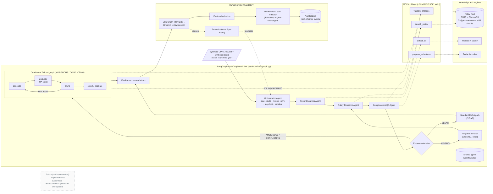
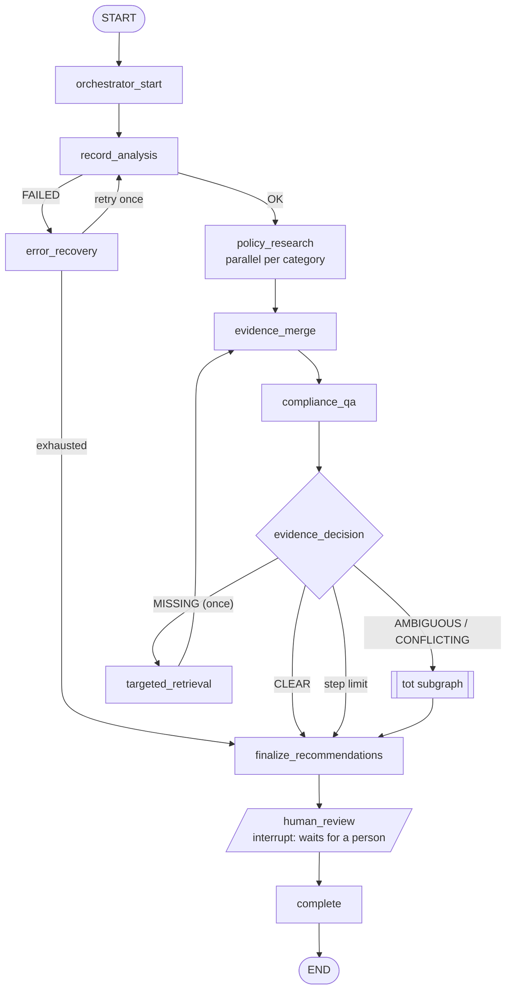
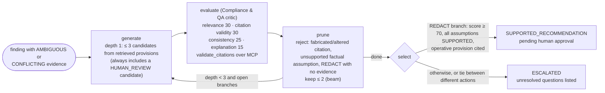
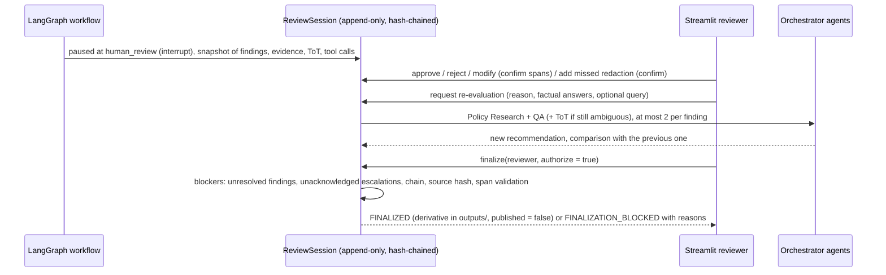

# Final Architecture Diagrams

These diagrams describe the system **as implemented** at the final evaluation commit (`7a1a875`)
plus the Milestone 7 documentation changes. Anything not implemented is drawn in grey and labelled
"future". The Tree of Thought (ToT) is a **conditional subgraph** run by the Orchestrator. It is
not a fifth agent.

| File | What it is | How to edit |
|---|---|---|
| [final_architecture.png](final_architecture.png) | Presentation export (2667 × 1500) | Regenerate with the build script |
| [final_architecture.pptx](final_architecture.pptx) | The same diagram as native, editable PowerPoint shapes | PowerPoint |
| [final_architecture.drawio](final_architecture.drawio) | The same nodes and edges for diagrams.net | <https://app.diagrams.net> or the VS Code draw.io extension |
| This file | Mermaid versions: logical architecture, workflow graph, ToT subgraph, review sequence | Any Mermaid renderer (GitHub renders them inline) |

The PNG, PPTX and draw.io files are generated from one definition,
`docs/final_capstone/build/diagram.py`:

```bash
python docs/final_capstone/build/build_architecture.py   # needs python-pptx; the PNG export also needs Microsoft PowerPoint
```

## 1. Logical architecture



## 2. Workflow graph (nodes exactly as registered in `graph.py`)



Route priority at `evidence_decision`: step limit, then record-analysis failure, then MISSING
(if the retry is unused), then AMBIGUOUS or CONFLICTING (ToT), then standard.

## 3. ToT subgraph (`app/workflows/tot.py`)



Depth 2 (VERIFICATION) checks factual assumptions against the record and may spend the run's single
targeted retrieval. Depth 3 (CONCLUSION) records remaining gaps as unresolved questions.

## 4. Human review and finalization


