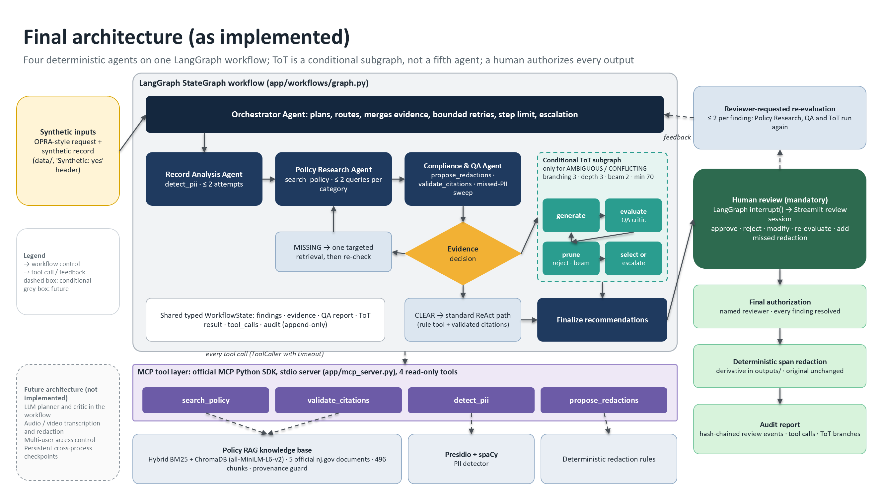
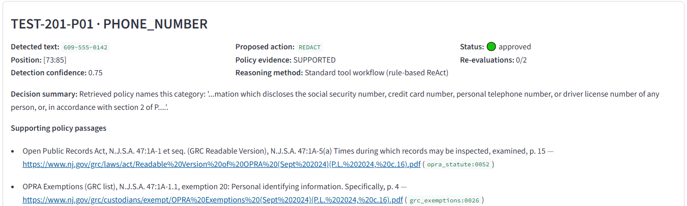
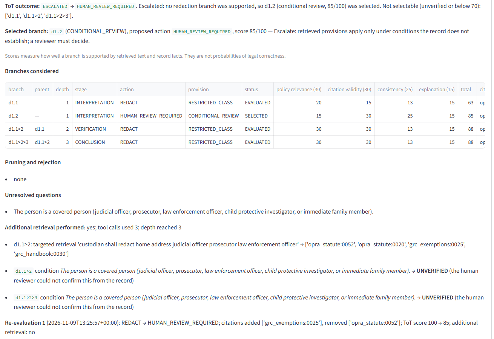
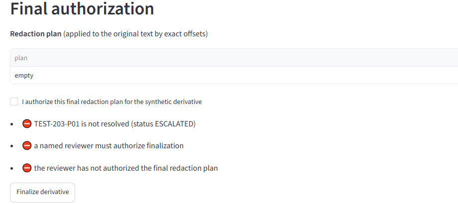

# Agentic Public Records Compliance Assistant: Final Capstone Report

**Course:** Carnegie Mellon University, Building Agentic AI Systems. Capstone, Research Assistant track.
**Date:** November 2026.
**Final evaluation commit:** `7a1a875`.

**Evidence rule for this report.** Every number, trace excerpt and screenshot comes from a run that
was actually executed and saved in the repository. Where a design element was proposed but not
built, or built differently, the report says so. Status labels used throughout:

| Label | Meaning |
|---|---|
| **Implemented** | Code exists, runs, and has tests or recorded runs |
| **Partially implemented** | Code exists, but not all of it has been run or exercised |
| **Changed** | Built differently from the proposal |
| **Proposed / deferred** | Not built |

---

## 1. Executive summary

The Agentic Public Records Compliance Assistant helps a public-records reviewer prepare a synthetic
record for release under New Jersey's Open Public Records Act (OPRA). It runs as a sequence of steps:

1. **Detect.** The Record Analysis Agent finds candidate personal information.
2. **Retrieve.** The Policy Research Agent retrieves the governing text from five official nj.gov
   policy documents.
3. **Recommend and check.** The Compliance & QA Agent proposes redactions, validates every citation
   and classifies the evidence.
4. **Route.** The Orchestrator Agent routes each case to the standard ReAct path, a targeted
   retrieval, or a bounded Tree of Thought (ToT) subgraph.
5. **Human review.** The workflow stops for a person. A named reviewer approves, rejects, modifies
   or sends items back for re-evaluation. Only after explicit authorization is a deterministic
   redacted derivative written, with a hash-chained audit trail. Nothing is published.

**What was built.** The four agents run on a LangGraph `StateGraph`. All tools are served by an MCP
server built with the official MCP Python SDK. ToT is a conditional subgraph, not a fifth agent.

**The agents are deterministic and rule-based.** No LLM is called anywhere in the workflow. The
"ReAct" behaviour is a bounded, rule-driven decide → call tool → observe loop. A Claude planner was
built in Milestone 3 but was tested only with a fake client.

**Evaluation.** 22 synthetic scenarios were run under two configurations, ReAct-only (A) and
ReAct + selective ToT (B), for 44 runs:

| Result | A | B |
|---|---|---|
| PII detection precision | 1.000 | 1.000 |
| PII detection recall | 0.895 (17/19) | 0.895 (17/19) |
| Unsupported redactions | 0 | 0 |
| Escalation recall | 11/11 | 11/11 |
| End-to-end success | 22/22 | 22/22 |

- **What ToT changed:** exactly one decision. In S12 (a retired judge's home address) it selected a
  fully verified, cited redaction instead of abstaining. Cost: 13 extra tool calls and about 0.11 s
  per ToT case.
- **Before evaluation-driven fixes, ToT was harmful:** it made two unsupported redactions. Comparing
  A against B exposed four defects, which are now fixed and covered by regression tests.
- **Safety:** 16 of 16 safety checks passed over all runs, 40 of 40 mapped guardrail tests passed,
  and the full suite passed 314 of 314 tests.
- **Conclusion:** selective ToT did no harm after the fixes and helped one ambiguous case. The
  evidence does not support a general accuracy claim.

## 2. Problem statement and intended users

**The task.** Before a public record is released under OPRA, a custodian must:
- find personal information such as personal phone numbers, driver licence numbers, home addresses
  and IP addresses;
- determine whether the statute or Government Records Council (GRC) guidance requires redaction;
- redact consistently and record the basis.

The work is manual and repetitive. Errors cut both ways: a missed value is a privacy breach, and an
unsupported redaction wrongly withholds public information.

**Intended users.** Public-records custodians and review staff, as stated in the original proposal.

**The assistant's role** is to reduce repetitive work while "keeping the final decision with a
human reviewer" (proposal). It finds candidates, retrieves and cites the governing text, explains
uncertainty, and prepares the derivative. It never decides disclosure.

**Scope.** Synthetic text records only. Public nj.gov policy documents only. No real records,
personal data, evidence-management integrations or release operations.

## 3. Why a standalone LLM is insufficient

| A single prompt to an LLM | What the task requires | How this system provides it |
|---|---|---|
| May produce a plausible but non-existent statute or section | Every redaction tied to authoritative text | Recommendations can cite only chunk ids returned by retrieval. `validate_citations` checks that each chunk exists, the excerpt is verbatim, and the source is official. The QA agent vetoes invalid citations |
| Knows only its training data | Current statute text (OPRA as amended by P.L. 2024, c.16) | Retrieval over five official nj.gov documents ingested with provenance |
| Cannot act | Detection, retrieval, validation, redaction | Tools exposed through MCP |
| One pass; no recovery | Retries, fallbacks, escalation | Bounded loops: ≤ 2 detection attempts, ≤ 2 queries per category, one targeted retry, step limit 30, tool timeouts |
| May follow instructions embedded in documents | Documents are evidence, not instructions | Rule-based agents never execute passage text; a provenance guard prevents non-official text from being cited |
| No record of why | Auditable decisions | Typed state, tool-call history, ToT node tables, hash-chained review events, audit report |
| Implies a decision | Human authority over disclosure | LangGraph `interrupt()` before completion; finalization requires a named reviewer and explicit authorization |

## 4. Evolution from Checkpoint 1.1 through Checkpoint 5.1

Full mapping, with gaps: [checkpoint_traceability.md](checkpoint_traceability.md).

| Checkpoint | Decision | Outcome in the final system |
|---|---|---|
| **1.1** Proposal (assumed to be the project proposal document) | Research assistant for OPRA redaction of video, audio and documents; policy-backed reasons; approve, reject or modify; escalate when unclear | Implemented for text; audio and video deferred |
| **2.1** Reasoning, memory, tools (known only from 4.1's summary) | ReAct; short-term and long-term memory; external tools | Rule-based ReAct loop; typed state; ChromaDB + BM25 index |
| **3.1** Executed retrieval | Real nj.gov ingestion; the phone-number query; agent over MCP; missing evidence | Reproducible (`python -m app.checkpoint_3_1`). 47:1A-5(a) retrieved at rank 2 (cosine 0.6537). Re-verified in Milestone 7 |
| **4.1** Tree of Thought | Two versions were written: "do not use ToT" and "use ToT selectively". The selective version was implemented: 3 / 3 / 2 beam search, 30/30/25/15 rubric, minimum 70 | Implemented as a LangGraph subgraph; the critic is deterministic instead of a CrewAI/LangChain critic agent |
| **5.1** Multi-agent architecture | Orchestrator plus three workers; hybrid graph; structured shared state; QA can request more evidence | Implemented on LangGraph; research runs after detection (it depends on the findings) and in parallel across categories |

**The ToT reversal.** The 4.1 drafts record a real design debate. The first draft argued that the
problem is evidence, not breadth of reasoning, and that more branches could mean more unsupported
answers. The final design adopts ToT *selectively*, guarded by mandatory evidence checks. The
evaluation partly vindicated the first draft: before the fixes, ToT's extra branches produced two
unsupported redactions that the ReAct path did not.

## 5. Overall logical architecture



*Figure 1. Final architecture as implemented. Editable sources: `architecture/final_architecture.drawio`,
`architecture/final_architecture.pptx`, and Mermaid diagrams in `architecture/README.md`.*

| Layer | Components |
|---|---|
| Inputs | Synthetic OPRA-style request and record (`data/`). Every file carries a `Synthetic: yes` header, and the loader refuses files without it |
| Workflow | LangGraph `StateGraph` (`app/workflows/graph.py`) with a typed `WorkflowState`. Nodes: `orchestrator_start`, `record_analysis`, `policy_research`, `evidence_merge`, `compliance_qa`, `evidence_decision`, `targeted_retrieval`, `error_recovery`, `tot` (subgraph), `finalize_recommendations`, `human_review` (interrupt), `complete` |
| Agents | Orchestrator, Record Analysis, Policy Research, Compliance & QA (`app/workflows/agents.py`, `graph.py`) |
| Reasoning | Standard path for CLEAR evidence; targeted retrieval for MISSING; ToT subgraph (`app/workflows/tot.py`) for AMBIGUOUS or CONFLICTING |
| Tools | MCP server (`app/mcp_server.py`): `detect_pii`, `search_policy`, `propose_redactions`, `validate_citations` |
| Knowledge | Policy index (`app/policies/`): 5 documents, 496 chunks, BM25 + ChromaDB; Presidio + spaCy detector; deterministic redaction rules |
| Human review | `app/review/` (session, re-evaluation, redaction, report) and the Streamlit app `app/review_app.py` |
| Outputs | Derivative in `outputs/derivatives/` (never the original path); review sessions in `outputs/reviews/`; audit report JSON |

## 6. MCP tool integration

**Status: Implemented.**

The server is `app/mcp_server.py`. It uses the official MCP Python SDK 2.3.0 (`MCPServer`) over
stdio. Its four tools wrap one validated `ToolService` (`app/tools/service.py`). Configuration comes
from environment variables: `PRA_DATA_DIR`, `PRA_SEMANTIC`, `PRA_POLICY_DOC_IDS` and `PRA_LOG_LEVEL`.

| Tool | Input → output | Called by | Notes |
|---|---|---|---|
| `detect_pii` | record id → findings (category, span, text, confidence) | Record Analysis | Presidio 2.2.364 + spaCy `en_core_web_md`; custom recognizers for street addresses (case-sensitive since fix F3), NJ driver licence, date of birth |
| `search_policy` | query, k → status + verbatim passages with metadata | Policy Research; the ToT targeted retrieval | Hybrid retrieval with evidence thresholds |
| `propose_redactions` | record id, finding ids, chunk ids → per-finding action | Compliance & QA | Accepts chunk ids only, never free-text citations; REDACT requires a supporting chunk |
| `validate_citations` | chunk ids (+ excerpts) → exists / verbatim / official / valid | Compliance & QA; ToT critic | Marks non-nj.gov sources invalid (fix F1) |

**Safety properties:**
- every tool is read-only, so none writes records or publishes;
- unknown tools are refused;
- inputs and outputs are validated with Pydantic.

Tested by `test_every_mcp_tool_is_read_only`, `test_unknown_tools_are_refused` and
`test_call_unknown_tool`.

**Transport evidence:**
- `python -m app.mcp_client_demo` discovers and calls all four tools.
- The Milestone 4 and 5 demos run every agent tool call through the stdio server; their traces
  record transport `mcp`.
- `tests/test_mcp_integration.py` starts the server as a subprocess.
- All of these were re-run successfully in Milestone 7.
- The Milestone 6 evaluation used the in-process executor around the same `ToolService` to keep
  runs fast. This is stated in its environment block.

## 7. ReAct reasoning and tool-use workflow

**Status: Implemented as deterministic, rule-based ReAct. LLM-driven ReAct is only partially
implemented: the Claude planner was tested with a fake client only.**

- **Single agent (Milestone 3, `app/agents/react_agent.py`):** a bounded loop. A planner chooses
  the next action, an executor (in-process or MCP) runs it, the observation is recorded, and the
  loop repeats until finish or a limit.
- **Planners:**
  - `RulePlanner` (used everywhere);
  - `ClaudePlanner`, which builds tool-use requests for the Claude API but has never been run
    against the live API, because no API key was configured (`tests/test_claude_planner.py` uses a
    fake client).
- **Guardrails:** step limit, repeated-failure stop, and no REDACT without a policy reference
  (enforced by the schema).
- **In the multi-agent workflow,** each worker runs its own bounded decide → act → observe loop:
  - **Record Analysis:** calls `detect_pii`; on failure, retries (≤ 2 attempts) and never invents
    findings.
  - **Policy Research:** queries per category. If no passage names the category, it reformulates
    (≤ 2 queries). For categories OPRA lists outright, it continues until operative statutory text
    is found (fix F4).
  - **Compliance & QA:** runs `propose_redactions`, then independently validates every citation,
    classifies evidence (CLEAR / AMBIGUOUS / CONFLICTING / MISSING), and sweeps the text for
    possibly missed values.

**Recorded trace, Scenario A** (`docs/milestone_4/execution_traces/scenario_A.md`). Record:
*"…My personal phone number is 609-555-0142."*

| # | Agent | Tool | Result |
|---|---|---|---|
| 1 | record_analysis | `detect_pii` | PHONE_NUMBER (0.75) |
| 2 | policy_research | `search_policy` | SUFFICIENT: grc_exemptions:0026, opra_statute:0053, opra_statute:0052, grc_handbook:0031 |
| 3 | compliance_qa | `propose_redactions` | REDACT |
| 4 | compliance_qa | `validate_citations` | 5/5 valid |

Route: `standard` (ToT not invoked). Result: REDACT citing N.J.S.A. 47:1A-5(a), paused for human approval.

## 8. Semantic retrieval and policy knowledge base

**Status: Implemented.**

| Element | Implementation |
|---|---|
| Sources | 5 official nj.gov documents (`data/policy_documents/manifest.json`): OPRA statute, GRC readable version (Sept 2024, P.L. 2024 c.16); GRC OPRA exemptions list; GRC "Redacting Government Records" page; GRC Handbook for Records Custodians, 8th ed. (Jan 2025); AG Directive 2022-1 (body-worn cameras) |
| Ingestion | PDF/HTML extraction and cleaning; section-aware chunking (496 chunks), each carrying title, section label (for example `N.J.S.A. 47:1A-5(a)`), page, effective date and source URL. Checkpoint 3.1 ingestion checks the downloaded PDF against the indexed copy by SHA-256 |
| Keyword | BM25 |
| Semantic | ChromaDB with all-MiniLM-L6-v2 (ONNX) embeddings |
| Hybrid | Reciprocal-rank fusion, k = 4 |
| Evidence gate | Keyword: BM25 ≥ 6.0 plus term-coverage rules. Semantic: cosine ≥ 0.55. Otherwise **INSUFFICIENT**, and the only possible outcome is HUMAN_REVIEW_REQUIRED |
| Provenance guard | Only passages whose source URL starts with an official nj.gov prefix can support a recommendation. Others are recorded in `excluded_sources` (fix F1) |
| Untrusted content | Passages are data. Nothing in a passage is executed or followed |

**Executed example (Checkpoint 3.1, re-run in Milestone 7).**
- Query: *"What New Jersey law applies when a public record contains someone's personal telephone
  number?"*
- Result: rank 2, chunk `opra_statute:0052`, N.J.S.A. 47:1A-5(a), p. 15, cosine 0.6537.
- Excerpt: *"…the custodian thereof shall redact from that record any information which discloses
  the social security number, credit card number, personal telephone number, or driver license
  number of any person…"*



*Figure 2. Real reviewer UI (Scenario A): the recommendation shows the source title, statutory
section, page, URL and chunk id for each supporting passage.*

**Missing evidence (Scenario C, IP address).**
- Three searches returned passages, but none names IP addresses: two queries plus one targeted
  retry.
- The result is HUMAN_REVIEW_REQUIRED with **no citation**. The system never writes a citation of
  its own.

## 9. Multi-agent orchestration and communication

**Status: Implemented.**

| Agent | Responsibility | Bounded loop |
|---|---|---|
| Orchestrator | Plans; routes; merges findings with evidence; decides the route; invokes ToT; handles retries, step limit, escalation, termination | Step limit 30; LangGraph recursion limit |
| Record Analysis | Detects candidate personal data with offsets and confidence | ≤ 2 attempts; ≤ 1 recovery cycle |
| Policy Research | Retrieves verbatim passages per category; reformulates; performs targeted retrievals on request | ≤ 2 queries per category; 1 targeted retry |
| Compliance & QA | Proposes redactions; validates citations; classifies evidence; sweeps for missed values; acts as the ToT critic | One proposal and one validation pass per round |

**Coordination:**
- **Sequential** where outputs feed inputs: detect → research → merge → QA.
- **Parallel** inside policy research, one search task per category.
- **Conditional** at `evidence_decision`, in priority order: step limit, then detection failure,
  then MISSING (retry once), then AMBIGUOUS or CONFLICTING (ToT), then standard.

**Communication:**
- **Through shared typed state only.** Agents never message each other.
- **Appended fields.** List fields (`tool_calls`, `audit`, `transitions`, `escalations`) use
  `operator.add` reducers and are append-only.
- **Owned fields.** Every other field is written by its owning node.
- **The ToT keeps its own state.** Each thought node has a branch-local copy of evidence, so one
  branch cannot contaminate another. This is checked by a test and by a safety check over all
  evaluation runs.

**Recorded evidence:** five Milestone 4 scenarios, all checks passing, re-run in Milestone 7:

| Scenario | Route | Result |
|---|---|---|
| A | standard | REDACT, ToT not invoked |
| B | `tot` | REDACT, score 100 |
| C | targeted retry | escalated, no citations |
| D | ToT | unsupported branch rejected; escalated |
| D-budget | ToT | tool budget enforced; escalated |

## 10. Selective ToT design and implementation

**Status: Implemented (LangGraph subgraph `app/workflows/tot.py`), with the changes listed in the
table at the end of this section.**

### 10.1 Why ToT only for ambiguous scenarios

Most findings have one clear answer. For a personal phone number, 47:1A-5(a) requires redaction, and
exploring alternatives there only adds cost. Selective ToT keeps the standard path for CLEAR evidence
and spends extra reasoning only where an interpretation depends on conditions. For example, a home
address is protected only for certain classes of person. The measured cost on ToT cases is 1–3 extra
tool calls each.

### 10.2 The ambiguity trigger

`app/workflows/evidence.py` classifies each finding from retrieved text and the record only:

| Class | Rule | Route |
|---|---|---|
| CLEAR | Category listed without qualification (phone, driver licence, SSN, month and day of birth), operative language in a retrieved passage, detection confidence ≥ 0.6, no applicable exclusion | Standard path |
| AMBIGUOUS | Evidence exists but depends on conditions (who the person is, a definition or balancing test, low confidence) | **ToT** |
| CONFLICTING | A redaction provision and a possibly applicable exclusion (for example "shall not include … telephone number of a public agency") | **ToT** |
| MISSING | No retrieved passage names the category | One targeted retrieval, then escalate |

Measured: ToT activated on 7 of 7 ambiguous scenarios and on 0 of 14 straightforward ones.

### 10.3 Thought, node and branch representation

- **Thought:** an evidence-based interpretation. Example: "Redact: 47:1A-1.1 protects this home
  address if the person is a covered person."
- **Node (`ThoughtNode`):**
  - proposed action (REDACT or HUMAN_REVIEW_REQUIRED);
  - provision type;
  - cited chunk ids, with a branch-local copy of their text;
  - assumptions, each FACTUAL or LEGAL with a status (SUPPORTED / UNVERIFIED / REJECTED);
  - unresolved questions;
  - status and score.
- **Branch:** a path from a depth-1 interpretation through verification. The id records it, for
  example `d1.1>2`.

### 10.4 Branching factor 3, depth 3, beam width 2

| Depth | Stage | What happens |
|---|---|---|
| 1 | INTERPRETATION | Up to 3 candidates built only from retrieved provisions (restricted class, general operative, definition or balancing), always including a conservative HUMAN_REVIEW candidate |
| 2 | VERIFICATION | FACTUAL assumptions are checked against the record near the finding. If operative text is missing or a LEGAL assumption is open, the branch may spend the run's **single** targeted retrieval |
| 3 | CONCLUSION | Remaining gaps are recorded as unresolved questions |

After each depth, at most **2** eligible branches are kept (beam). `ToTConfig` defaults:
- `max_branching=3`, `max_depth=3`, `beam_width=2`, `min_score=70`;
- `max_tool_calls=6`, `time_budget_s=60`.

A test confirms that these limits cannot be raised beyond the design values
(`test_tot_limits_cannot_be_raised_beyond_design`).

### 10.5 Scoring rubric, mandatory checks and critic evaluation

The Compliance & QA Agent acts as the critic. It is **deterministic**, and it validates citations
through the `validate_citations` MCP tool.

| Criterion | Points | How it is scored |
|---|---|---|
| Policy relevance | 30 | 15 if a cited passage names the category. For REDACT: +10 for operative language, +5 for a statutory (primary) source |
| Citation validity | 30 | 30 if all citations validate. 15 for a REDACT candidate whose valid citations lack operative language. 0 if they could not be validated |
| Consistency with facts and conditions | 25 | 25 minus 12 for each assumption still UNVERIFIED |
| Explanation and uncertainty | 15 | Stated interpretation, unresolved questions listed, human-approval condition attached |

**Mandatory checks reject a branch immediately:**
- a fabricated citation (the chunk does not exist), an altered excerpt, or a non-official source;
- a FACTUAL assumption the record does not support;
- a REDACT branch with no evidence.

**Selection constraint.** A REDACT branch is selectable only if:
- every assumption is SUPPORTED;
- it cites an operative provision;
- it scores ≥ 70.

Low-confidence detections (< 0.6) add a FACTUAL "detection is correct" assumption that only a
reviewer can confirm (fix F2).

### 10.6 Beam-search selection, pruning and termination

| Rule | Behaviour |
|---|---|
| Pruning | Rejected branches are pruned with the reason recorded; branches beyond the beam get a "beam width" reason |
| Uncertain branches | Kept as UNVERIFIED, not discarded. This is the Checkpoint 4.1 mitigation for premature pruning |
| Selection | The highest-scoring selectable branch |
| Ties | Stronger primary source wins: statute, then GRC list, then handbook. A remaining tie between different actions is an unresolved material conflict and escalates |
| Termination | Search ends when no open branches remain, depth 3 is reached, or the tool or time budget runs out. When a budget runs out, the event is recorded and nothing unverifiable can be selected |

### 10.7 Missing evidence, unresolved conflicts and human escalation

- If no branch qualifies, the outcome is **ESCALATED**, with the unresolved questions listed.
- A selected REDACT still goes to the human reviewer as a *recommendation*. No branch can authorize
  disclosure.
- In review, the reviewer can answer FACTUAL conditions (`covered_person`, `not_agency_number`,
  `detection_correct`) and request re-evaluation. ToT then reruns with those answers.
- A reviewer cannot satisfy a LEGAL condition or create a citation (`test_reviewer_facts_are_factual_input_only`).

### 10.8 Real execution: Scenario B (retired judge's home address)

Source: `docs/milestone_4/execution_traces/scenario_B.md`.

| Branch | Depth | Action | Provision | Rel | Cit | Cons | Expl | Total | Status |
|---|---|---|---|---|---|---|---|---|---|
| d1.1 | 1 | REDACT | RESTRICTED_CLASS | 20 | 15 | 13 | 15 | 63 | evaluated (covered status unverified) |
| d1.2 | 1 | HUMAN_REVIEW_REQUIRED | CONDITIONAL_REVIEW | 15 | 30 | 25 | 15 | 85 | evaluated |
| d1.1>2 | 2 | REDACT | RESTRICTED_CLASS | 30 | 30 | 25 | 15 | **100** | **selected** |

**How the selection happened:**
- At depth 2, the covered-person assumption was SUPPORTED by the record ("retired Superior Court
  judge").
- The one targeted retrieval (*"custodian shall redact home address judicial officer prosecutor
  law enforcement officer"*) added the operative 47:1A-5(a) passage `opra_statute:0052`.

**Reviewer feedback in Milestone 5.** The reviewer answered `covered_person = unconfirmed`. ToT
reran, both REDACT branches became non-selectable (88, unverified), d1.2 (85) was selected, and the
item escalated.



*Figure 3. Real reviewer UI (Scenario B after re-evaluation): ToT outcome, selected branch, every
branch with its actual scores, unresolved questions and the targeted retrieval. Scores carry the
note that they are not probabilities of legal correctness.*

### 10.9 Implemented vs proposed (Checkpoint 4.1)

| 4.1 design element | Status |
|---|---|
| ToT only when evidence is ambiguous or conflicting | **Implemented** |
| Thought / node / branch representation (evidence, assumptions, action, open questions) | **Implemented** |
| Branching 3, depth 3, beam 2, beam search | **Implemented** and enforced |
| 30/30/25/15 rubric; minimum 70 | **Implemented** |
| Reject fabricated citations and unsupported factual assumptions | **Implemented** (2 rejections in the evaluation) |
| Ties go to stronger primary-source evidence; unresolved conflicts go to human review | **Implemented**. Covered by unit tests only, because no scenario produced a tie |
| Uncertain branches marked, not pruned; one targeted retrieval before pruning | **Implemented** (13 uncertain branches preserved) |
| Time, depth and tool-call limits | **Implemented** |
| Critic **agent** (CrewAI + LangChain) assessing relevance and explanation quality | **Changed:** a deterministic rubric inside the Compliance & QA Agent. Explanation quality is checked structurally only |
| Thought generator in CrewAI; controller in LangChain | **Changed:** a single LangGraph subgraph (generate → evaluate → prune → select) |
| Example branch types A (redact) / B (exception) / C (escalate) | **Implemented in spirit.** Exceptions such as "use by any government agency" are surfaced as open questions, not reasoned about as separate branches |

## 11. Human feedback, approval, redaction and auditability

**Status: Implemented.**

The workflow pauses at `human_review` (LangGraph `interrupt()`). A `ReviewSession` snapshot drives
the Streamlit app (`streamlit run app/review_app.py`).

| Capability | Behaviour |
|---|---|
| Per-finding decisions | Approve (refused for escalated items: nothing supported to approve); reject with an optional reason; modify exact spans (spans must be confirmed) |
| Re-evaluation | Reviewer-requested only, never automatic on rejection. Takes a structured reason, optional factual answers and an optional extra query. Runs through the same Policy Research and QA agents, plus ToT if still ambiguous. Limited to **2 per finding**, then MANUAL_RESOLUTION_REQUIRED. Records a before/after comparison |
| Reviewer-added redaction | For text the detector missed. QA flags possible misses (spelled-out or 7-digit numbers) as escalations. The reviewer selects the exact text, a category and a reason, then confirms. It is recorded as a human decision with no system policy basis claimed |
| Finalization | A separate step. Blocked, with reasons recorded, unless every finding is resolved, every escalation is acknowledged, a named reviewer authorizes, the event chain verifies, the source file is unchanged, and span validation passes |
| Deterministic redaction | The derivative is built by slicing the original text at validated offsets. Overlapping spans merge. Untouched segments are verified byte-identical. A redacted value repeated elsewhere blocks finalization |
| Originals | Never modified. The derivative goes to `outputs/derivatives/…`. The original record's hash is checked |
| Audit | Append-only, hash-chained review events (actor, UTC time, payload, previous hash). The audit report contains the workflow snapshot, tool calls, ToT tables, re-evaluations, decisions and finalization. `published: false` |



*Figure 4. Real reviewer UI (Scenario C): finalization refused for an escalated finding with no
policy basis.*

Full-page captures of all three scenarios are in `docs/final_capstone/screenshots/`. Recorded
sessions and audit reports are in `docs/milestone_5/`.

## 12. Evaluation methodology

Details: [evaluation_summary.md](evaluation_summary.md).

| Item | Choice |
|---|---|
| Dataset | 22 synthetic scenarios, 19 expected findings: clear categories, detector edge cases, decoys, missing evidence, ambiguous and conflicting policy, tool faults, prompt injection (in a retrieved document and in the record), reviewer rejection |
| Configurations | A: `enable_tot=False`. B: `enable_tot=True`. Everything else identical |
| Runs | 44 (one trial each; agents are deterministic) |
| Metrics | Detection precision and recall; recommendation in acceptable set and preferred; grounded citation accuracy; unsupported redactions; workflow completion; end-to-end success; escalation recall and false escalation rate; tool-failure safe handling and recovery; latency; tool calls; ToT activation, branch validity, pruning, termination, invariants; 16 safety checks |
| Reviewer | Scripted from scenario definitions |
| Integrity | Expected outcomes were not changed to make results pass. The pre-fix run is preserved. All metrics are recomputable from raw traces (`python -m app.evaluation.verify`, 33/33 match) |

## 13. Actual evaluation results

| Metric | A: ReAct-only | B: ReAct + ToT |
|---|---|---|
| Detection precision | 1.000 (17/17) | 1.000 (17/17) |
| Detection recall | 0.895 (17/19) | 0.895 (17/19) |
| Recommendation in acceptable set | 1.000 (17/17) | 1.000 (17/17) |
| Preferred recommendation | 0.882 (15/17) | 0.941 (16/17) |
| Grounded citation accuracy | 1.000 (6/6) | 1.000 (7/7) |
| Unsupported redactions | 0 | 0 |
| Workflow completion | 22/22 | 22/22 |
| End-to-end success | 22/22 | 22/22 |
| Escalation recall / false escalation rate | 11/11 / 0/9 | 11/11 / 0/9 |
| Tool failure: safe handling / full recovery | 3/3 / 3/3 | 3/3 / 3/3 |
| Latency mean / median / p95 (s) | 0.377 / 0.371 / 1.059 | 0.388 / 0.364 / 0.987 |
| Mean tool calls per scenario | 3.59 | 4.18 |
| LLM calls / cost | 0 / $0 | 0 / $0 |

**ToT (B):**
- **Activation:** 7 TP, 0 FP, 0 FN, 14 TN (S16 not scored).
- **Branches:** 8 runs; 25 branches (20 supported by official evidence); 2 rejected for unsupported
  factual assumptions; 0 for fabricated citations; 13 uncertain branches preserved, 0 lost.
- **Limits:** 0 invariant violations.
- **Outcomes:** 1 fully supported REDACT, 7 escalations.
- **Cost:** 13 extra tool calls.

**Detection misses.** S04 (phone spelled out in words) and S05 (7-digit number). Both still succeed
end to end, because QA flags them and the scripted reviewer adds the redaction. The detector itself
does not catch them.

**Defects found and fixed** (pre-fix B: 2 unsupported redactions, 3 false activations):

| # | Defect | Fix |
|---|---|---|
| F1 | Injected non-official text could be cited | Provenance guard |
| F2 | ToT ignored low detection confidence | Reviewer-only "detection is correct" condition |
| F3 | Case-insensitive address regex | Recognizer made case-sensitive |
| F4 | Retrieval missed operative text for a listed category | Research continues until operative text is found |

## 14. ReAct-only vs ReAct+ToT comparison

Details: [react_vs_tot_comparison.md](react_vs_tot_comparison.md).

| Question | Measured answer |
|---|---|
| Decision quality | +1 preferred decision (S12). All 17 matched findings were acceptable in both configurations |
| Evidence coverage | S12 gained the operative 47:1A-5(a) citation through the targeted retrieval. Grounded accuracy was 1.000 in both |
| Escalation behaviour | No change (11/11, 0/9) |
| Safety | No difference after the fixes. Worse with ToT before the fixes (2 unsupported redactions) |
| Cost | +13 tool calls in total (1–3 per ToT case); +0.111 s mean per ToT case; $0 |
| Conclusion | **Inconclusive for general accuracy.** Selective ToT did no harm after the fixes and helped one ambiguous case. A rubric score measured consistency, not correctness: before the fixes, ToT rated two wrong selections "fully supported" |

## 15. Safety controls and failure handling

| Risk | Control | Evidence |
|---|---|---|
| Fabricated citations | Chunk-id-only citations; `validate_citations`; QA veto; ToT rejection | 5 guardrail tests; safety check "every citation is an existing chunk of an official source" (44/44 runs) |
| Unsupported legal conclusions | INSUFFICIENT or MISSING → HUMAN_REVIEW_REQUIRED; schema forbids REDACT without a reference; REDACT selection needs verified assumptions | 4 guardrail tests; Scenario C |
| Prompt injection | Rule-based agents; provenance guard; record text never treated as instructions | S20: injected document never cited and injected citation `47:1A-99` never repeated (A and B). S22: instructions inside the record ignored; expected outcome in both configurations |
| Modifying originals | Read-only tools; hash checks; derivative path checks | 3 tests; safety check over 44 runs |
| Finalization without approval | `interrupt()`; named reviewer plus explicit authorization; blockers | 7 tests; Scenario C blocked |
| Unbounded loops | Step limit, retry limits, ToT depth, beam and tool budgets, re-evaluation limit | 7 tests; 0 invariant violations |
| Tool failure | Timeouts (`ToolCaller`); retry, then escalate; failed policy search becomes MISSING, never invented policy | S17–S19: 3/3 safe handling and recovery |
| Cross-branch contamination | Branch-local evidence copies | Test plus safety check |
| Secrets and sensitive data | `.env` git-ignored; no keys needed; synthetic-only loader; reserved example values (555-01xx phones, RFC 5737 IPs, example.com) | Milestone 7 scan: [final_verification.md](final_verification.md) |

## 16. Limitations, lessons learned and future improvements

Full list: [limitations.md](limitations.md).

### Limitations

- **No LLM in the loop.** The agents are deterministic, so the results do not speak to LLM planning,
  LLM hallucination or LLM injection resistance.
- **Detector gaps.** Recall is 17/19. Spelled-out and 7-digit numbers are flagged for the reviewer,
  not detected; other formats would be missed.
- **Small evaluation set.** 22 self-authored scenarios, 7 ToT cases, and a simulated reviewer.
- **Narrow corpus.** Five documents; retrieval is sensitive to wording.
- **Prototype operation.** Text only; single local reviewer; no access control; in-memory graph
  checkpoints.

### Lessons learned

1. **A baseline comparison finds what unit tests do not.** Running A against B exposed four
   defects. Two of them produced harm only when ToT was on.
2. **Scores are not correctness.** ToT rated two wrong selections as fully supported. The protection
   came from mandatory evidence checks and the human gate, not from the score.
3. **Controlling evidence beats generating more reasoning.** The provenance guard and
   operative-text requirement did more for safety than additional branches.
4. **Deterministic first.** Rule-based agents made every decision reproducible and every metric
   recomputable. That made the evaluation trustworthy, at the cost of LLM flexibility.
5. **Escalation is a feature.** Most ambiguous cases end correctly with "human review required";
   the system's job there is to package the evidence and questions.

### Future improvements (not implemented)

- An LLM thought generator or critic behind the same validation gates, evaluated against these
  scenarios plus independently written ones.
- Detector improvements for spelled-out and partial numbers.
- More policy sources (agency rules, GRC decisions) with provenance checks.
- Synthetic audio and video (transcription, frame redaction): the original Stage 8.
- Multi-user review with authentication and second-reviewer sign-off.
- A usability study with records staff.

---

## Appendix A. Feature verification matrix

Verified in Milestone 7 against code, tests and recorded runs. "Run in M7" means it was re-executed
during Milestone 7 (see [final_verification.md](final_verification.md)).

| Feature | Status | Evidence | Run in M7 |
|---|---|---|---|
| Synthetic data + loader refusing non-synthetic files | Implemented | `app/data_loader.py`; `tests/test_data_loader.py` (17) | Yes (`python -m app.main`) |
| Pydantic schemas (findings, references, recommendations, decisions, state) | Implemented | `app/schemas.py`, `app/workflows/state.py`; `tests/test_schemas.py` (26) | Yes (suite) |
| Policy ingestion from nj.gov with provenance | Implemented | `app/policies/ingest.py`; `docs/checkpoint_3_1/01_*` | **Network download failed in M7** (no DNS in this environment); local-copy path passed |
| Keyword (BM25), semantic (ChromaDB) and hybrid retrieval with thresholds | Implemented | `app/policies/`; `tests/test_policy_*` | Yes |
| PII detection (Presidio + custom recognizers) | Implemented; recall 17/19 | `app/tools/pii.py`; `tests/test_tools_pii.py` | Yes |
| MCP server with 4 read-only tools (official SDK, stdio) | Implemented | `app/mcp_server.py`; `tests/test_mcp_integration.py`; `mcp_client_demo` | Yes |
| Single ReAct agent, rule-based planner | Implemented | `app/agents/`; `tests/test_agent.py` (13) | Yes (`agent_demo`, local and MCP) |
| LLM-driven ReAct (Claude planner) | **Partially implemented:** fake client only, never run live | `tests/test_claude_planner.py` | Not run (no API key) |
| Four-agent LangGraph orchestration | Implemented | `app/workflows/`; `tests/test_m4_workflow.py`, `test_m4_scenarios.py` | Yes (`m4_demo`, 5/5 scenarios) |
| Standard cases bypass ToT | Implemented | Scenario A; 14/14 TN in the evaluation | Yes |
| Ambiguous cases invoke ToT | Implemented | Scenario B; 7/7 TP | Yes |
| ToT branching, depth, beam, scoring, pruning, budgets | Implemented | `tests/test_m4_tot.py` (18); 0 invariant violations | Yes |
| ToT tie-breaking and beam pruning in real scenarios | Implemented; **unit-test evidence only** | `test_beam_width_limits_retained_candidates`, `test_tie_goes_to_stronger_primary_source`, `test_unresolved_material_conflict_escalates` | Yes (suite) |
| LLM critic agent for ToT | **Not implemented** (changed to a deterministic critic) | — | — |
| Missing evidence → safe escalation | Implemented | Scenario C; S10, S11, S18 | Yes |
| Human review interrupt / resume | Implemented | `test_only_human_approval_authorizes_disclosure` | Yes |
| Streamlit reviewer UI | Implemented | `app/review_app.py`; `tests/test_m5_app.py` (6); screenshots | Yes (screenshots captured in M7) |
| Re-evaluation with structured feedback (≤ 2) | Implemented | `tests/test_m5_review.py`; Scenario B | Yes (`m5_demo`) |
| Reviewer-added redaction for missed text | Implemented | `tests/test_m6_manual_redaction.py` (11 test functions) | Yes (suite) |
| Deterministic redaction + validation | Implemented | `app/review/redact.py`; `tests/test_m5_redact.py` (9) | Yes |
| Finalization blockers / explicit authorization | Implemented | `tests/test_m5_review.py`; Scenario C | Yes |
| Hash-chained audit log and audit report | Implemented | `app/review/session.py`, `report.py` | Yes |
| Prompt-injection resistance (retrieved document, record text) | Implemented (rule-based agents) | S20, S22; F1 tests | Yes (`evaluation.run`) |
| Evaluation harness, metrics, A/B comparison | Implemented | `app/evaluation/`; `tests/test_m6_evaluation.py` (17) | Yes (rerun identical; verify 33/33) |
| Audio / video redaction | **Deferred** | — | — |
| Multi-user access control, persistent checkpoints | **Not implemented** | — | — |

## Appendix B. Differences from the original proposal

| Area | Originally planned (proposal and checkpoints) | Implemented | Why changed | Effect on reliability and scope |
|---|---|---|---|---|
| Record types | Video, audio, transcripts, documents | Text records only | Time; text covers the core reasoning; synthetic media pipeline not needed to demonstrate agents | Narrower scope; transcription tool and OpenCV/FFmpeg deferred (Stage 8) |
| Reasoning engine | ReAct with an LLM (implied by 2.1/3.1/4.1) | Deterministic rule-based ReAct; Claude planner built but untested live | No API credentials; reproducible, testable behaviour; avoid hallucination risk in a compliance task | Every result reproducible and recomputable; no evidence about LLM behaviour |
| Frameworks for ToT | CrewAI + LangChain + MCP | LangGraph + MCP | One orchestration framework (LangGraph was already the workflow engine); fewer dependencies | Simpler state handling; branch state isolated by design |
| ToT critic | "Critic agent" assessing relevance and explanation quality | Deterministic rubric inside Compliance & QA | Without an LLM, explanation quality cannot be judged semantically | Explanation criterion is structural; mandatory checks unchanged |
| ToT adoption | 4.1 drafts: first "no ToT", then "selective ToT" | Selective ToT | Ambiguous provisions (restricted classes, exclusions) needed structured alternatives | One measured gain (S12); pre-fix harms found and fixed |
| Agent coordination | Record analysis and policy research coordinated, partly in parallel (5.1) | Research runs after detection; parallel across categories | What to research depends on what was found | Clearer data flow; no wasted retrieval |
| Feedback on rejection | "If a proposed redaction is rejected, the agent can review the evidence and policy again" (proposal) | Rejection is final; re-evaluation is an explicit reviewer request, ≤ 2 per finding | Avoid automatic loops; keep the human in control | Bounded, auditable feedback |
| Missed-PII check | "A final review step can also check the proposed output for possible missed sensitive information" | QA sweep for two missed formats + reviewer-added redaction | Detector gaps found in evaluation (S04, S05) | Gaps flagged, not solved |
| Evaluation transport | Not specified | In-process executor for the evaluation; MCP for demos and integration tests | Speed and determinism of 44 runs | Same `ToolService`; MCP covered separately |
| Additions not in the proposal | — | Provenance guard; low-confidence condition; hash-chained events; finalization blockers; metric recomputation script | Found necessary during evaluation and review design | Stronger safety guarantees |

## Appendix C. Reproducibility

- **Final evaluation commit:** `7a1a875` ("Milestone 6: evaluation, guardrails, ToT validation,
  reviewer-added redactions").
- **Environment:** Python 3.14.7 on Windows 10. Package versions are pinned in `requirements.txt`;
  key ones are langgraph 1.2.20, chromadb 1.5.9, presidio-analyzer 2.2.364, mcp 2.3.0,
  streamlit 1.66.0.
- **Clean-clone check (Milestone 7):** install exit 0 in 272 s, then 314 tests passed.

```bash
python -m venv .venv && .venv/Scripts/activate        # Windows; use source .venv/bin/activate elsewhere
pip install -r requirements.txt
python -m pytest                                       # 314 passed
python -m app.checkpoint_3_1                           # real-source retrieval demo (needs network; --offline uses the local copy)
python -m app.m4_demo                                  # four-agent workflow + ToT scenarios over MCP
python -m app.m5_demo                                  # review scenarios A/B/C
streamlit run app/review_app.py                        # reviewer UI
python -m app.evaluation.run --tag rerun               # evaluation (does not overwrite the committed final results)
python -m app.evaluation.verify                        # recompute committed metrics from raw traces
```

## Appendix D. Evidence index

| Evidence | Location |
|---|---|
| Real-source retrieval demo | `docs/checkpoint_3_1/` |
| Workflow and ToT traces | `docs/milestone_4/execution_traces/` |
| Review sessions, audit reports | `docs/milestone_5/review_scenarios.md`, `docs/milestone_5/scenarios/` |
| Evaluation results, ToT comparison, safety tests, raw traces | `docs/milestone_6/` |
| Screenshots of the running app | `docs/final_capstone/screenshots/` |
| Milestone 7 verification logs | `docs/final_capstone/verification_logs/` |
| Architecture sources | `docs/final_capstone/architecture/` |
