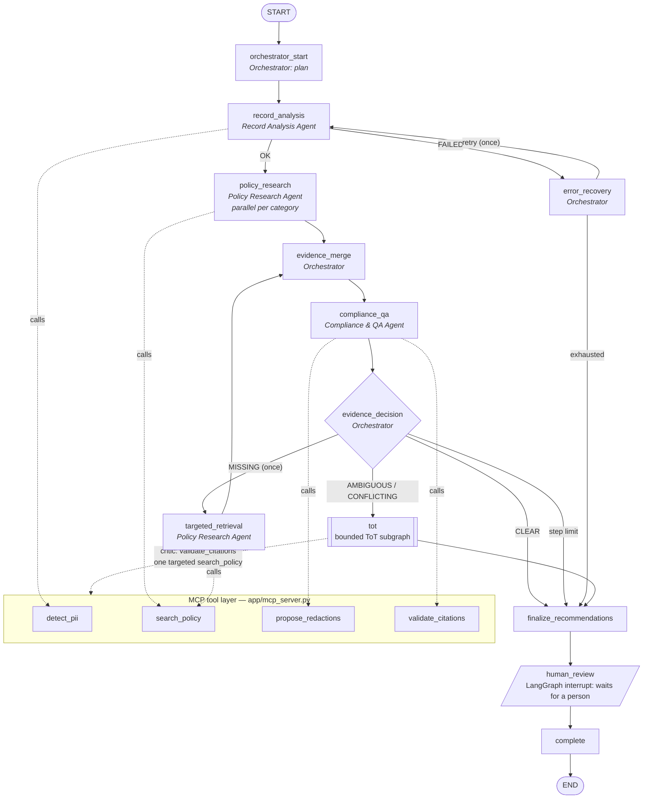

# Milestone 4 — Multi-Agent Architecture

Implements the four-agent design from Checkpoint 5.1 as a LangGraph workflow (`app/workflows/`),
with the Checkpoint 4.1 Tree of Thought used only for ambiguous or conflicting evidence.

> **What kind of agents these are.** All four agents are deterministic. They choose and sequence
> tool calls by fixed rules; no LLM is called anywhere in the Milestone 4 workflow. The ReAct
> pattern (decide → call tool → observe → decide) is implemented as bounded rule-based loops.
> The Milestone 3 Claude planner has not been run against the live API and is not used here.

## Workflow graph (as implemented)

Every path ends at `human_review`. Policy research runs **after** record analysis because what to
research depends on what was found; within that step, categories are researched in parallel.

## Agents and responsibilities

| Agent | Module | Responsibilities | Bounded loop |
|---|---|---|---|
| **Orchestrator** | `graph.py` `Orchestrator` | Owns goal and state; routes work; merges findings with evidence; decides CLEAR / AMBIGUOUS / CONFLICTING / MISSING / ERROR; invokes ToT only when needed; handles retries, failures, step limit, escalation, termination | Step limit (default 30) and LangGraph recursion limit |
| **Record Analysis** | `agents.py` `RecordAnalysisAgent` | Runs `detect_pii` on the synthetic record; returns structured findings with offsets and confidence; on failure returns `FAILED` with errors, never invented findings | ≤ 2 attempts per run; ≤ 1 recovery cycle |
| **Policy Research** | `agents.py` `PolicyResearchAgent` | Retrieves NJ OPRA/GRC passages with `search_policy`, keeping exact chunk text and metadata; reformulates once if no passage names the category; one targeted retrieval when the Orchestrator (missing evidence) or the ToT controller asks | ≤ 2 queries per category; 1 targeted retry |
| **Compliance & QA** | `agents.py` `ComplianceQAAgent` | Runs the deterministic `propose_redactions` rule tool, then independently validates every citation (`validate_citations`), classifies evidence per finding, sweeps for possibly missed values, and acts as the ToT critic | One proposal + one validation per pass |

There is no fifth agent for ToT: the ToT controller is part of the Orchestrator and reuses the
Policy Research Agent (targeted retrieval) and the Compliance & QA Agent (critic).

## Coordination

A hybrid graph:

- **Sequential** where outputs feed inputs (record analysis → policy research → merge → QA).
- **Parallel** within policy research, with one search task per finding category.
- **Conditional** at `evidence_decision`, in this priority order:
  1. step limit reached → human review;
  2. record analysis failed → error recovery;
  3. any MISSING evidence and the retry not yet used → targeted retrieval;
  4. any AMBIGUOUS or CONFLICTING evidence → ToT;
  5. otherwise → standard.
- **Bounded loops**:
  - the missing-evidence retry runs at most once, through `targeted_retrieval → evidence_merge → compliance_qa → evidence_decision`;
  - error recovery runs at most once;
  - inside the ToT: depth ≤ 3, beam ≤ 2, tool-call and time budgets.

## Communication

- **Through state only.** Agents never message each other. Each node reads the typed
  `WorkflowState` and returns a partial update.
- **Accumulated fields.** List fields annotated with `operator.add` accumulate across nodes:
  `tool_calls`, `audit`, `transitions`, `escalations`.
- **Owned fields.** Every other field is written by the node that owns it.
- **Isolated ToT state.** The ToT runs in its own subgraph with `ToTState`. Each `ThoughtNode`
  carries its own copy of the evidence and assumptions, so verifying one branch cannot change
  another. The trace for Scenario B shows the parent node unchanged after its child added a citation.
- **MCP stays the tool interface.** The demo runs every tool call through the stdio MCP server.

## State schema (`app/workflows/state.py`)

| Concern | Type | Written by |
|---|---|---|
| Request context | `RequestContext`, plus the read-only `record_text` | `initial_state` |
| Configuration | `WorkflowConfig`, which contains `ToTConfig` | caller |
| Record analysis findings | `RecordAnalysisResult`, `list[SensitiveDataFinding]` | record_analysis |
| Retrieved policy evidence | `list[CategoryEvidence]` (verbatim `PolicyChunk`s, queries, status) | policy_research, targeted_retrieval |
| Evidence status | `QAReport.assessments: list[EvidenceAssessment]` (`EvidenceDecision`) | compliance_qa |
| Citation checks | `QAReport.citation_checks`, `invalid_citations` | compliance_qa |
| Candidate thoughts and branches | `ThoughtNode` (in `ToTResult.nodes`) | ToT subgraph |
| Branch scores | `BranchScore` (30 / 30 / 25 / 15) | ToT critic |
| Pruning reasons | `PruneRecord` | ToT prune step |
| Tool-call history | `list[ToolCallRecord]` (agent, tool, arguments, status, summary, ms) | every agent |
| Retry counters | `RetryCounters` | record_analysis, targeted_retrieval, error_recovery |
| Recommendation | `list[RedactionRecommendation]` | finalize_recommendations |
| Human-review status | `HumanReviewStatus` (`HumanDecision` validated on resume) | human_review |
| Completion status | `CompletionStatus` | runner / complete |
| Audit log | `list[AuditEvent]` (step, node, agent, event, detail) | every node |

## Reliability and safety controls

| Control | Implementation |
|---|---|
| Execution step limit | `WorkflowConfig.max_steps`, checked at `evidence_decision` and `error_recovery`; also the LangGraph recursion limit |
| Bounded retries | Record analysis ≤ 2 attempts and ≤ 1 recovery; ≤ 2 queries per category; missing-evidence retry ≤ 1; ToT targeted retrieval ≤ 1 |
| Tool timeouts | `ToolCaller` wraps every call in `asyncio.wait_for`. A timeout is recorded and treated as a failure |
| No fabricated sources | Tools accept chunk ids only. `validate_citations` checks that each chunk exists and its excerpt is verbatim. The QA veto downgrades any recommendation with an invalid citation, and the ToT rejects fabricated or altered citations |
| No unsupported redactions | REDACT is produced only under one of two conditions. **Standard path:** the evidence is CLEAR and the citations validated. **ToT path:** the selected branch has a score of at least 70, every assumption is SUPPORTED, and an operative provision is cited |
| Original records unchanged | Tools read records by id; a test hashes the record file before and after a run |
| Human approval | `human_review` calls LangGraph `interrupt()`. Only a validated `approve` decision sets `disclosure_authorized` |
| Audit | `audit`, `tool_calls`, `transitions` and the full ToT node tables are saved in the execution traces |
| Retrieved text is evidence, not instructions | The agents are rule-based and never execute or follow passage text |

## Implemented vs. not implemented

| Item | Status |
|---|---|
| Four agents, LangGraph routing, all five routes | Implemented and tested |
| Bounded ToT with scoring, pruning, ties, budgets | Implemented and tested |
| Human approval gate (interrupt / resume) | Implemented and tested |
| LLM-driven agents or LLM qualitative critic | **Not implemented.** The QA critic is deterministic rubric scoring |
| Reviewer "return for revision" loop that re-runs analysis | **Not implemented.** The status is recorded only (Stage 6) |
| Persistent checkpointing across processes | **Not implemented.** The in-memory checkpointer is per process |
| Keyword-only retrieval for Scenario A | Classifies A as AMBIGUOUS, because keyword search misses 47:1A-5(a). The workflow relies on semantic or hybrid retrieval |
