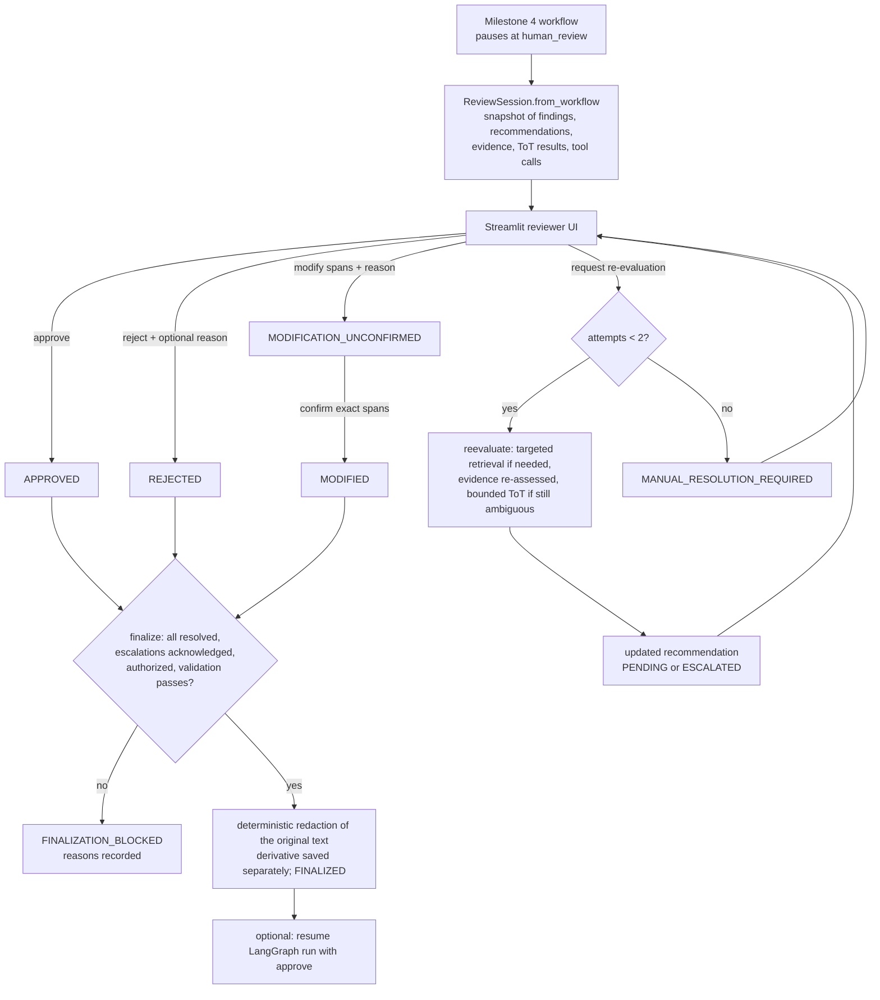

# Milestone 5 — Human Review Workflow

The Milestone 4 workflow ends paused at `human_review`. Milestone 5 turns that pause into a
structured review session (`app/review/session.py`) with a Streamlit interface
(`app/review_app.py`). No new agents were added: re-evaluation goes back through the
Orchestrator's existing Policy Research and Compliance & QA agents and the existing ToT controller.

## Flow

## Finding statuses

| Status | Meaning | Allowed next actions |
|---|---|---|
| PENDING | A supported REDACT recommendation awaits a decision | approve, reject, modify, request re-evaluation |
| ESCALATED | No supported redaction (missing or unresolved evidence) | reject, modify (explicit spans), request re-evaluation. **Approve is refused**: there is nothing supported to approve |
| APPROVED | The reviewer approved redacting exactly the detected span | change the decision (a new event), until finalized |
| MODIFICATION_UNCONFIRMED | The reviewer proposed different spans | confirm spans, or change the decision |
| MODIFIED | Spans confirmed against the original text | change the decision, until finalized |
| REJECTED | No redaction for this finding | change the decision, until finalized |
| REEVALUATION_IN_PROGRESS | Sent back to the Orchestrator | none until it completes |
| MANUAL_RESOLUTION_REQUIRED | The re-evaluation limit (2) was reached | reject or modify |

The UI shows these as pending, approved, modified, rejected and escalated, plus
"manual resolution required".

## Review events (append-only)

- **Every action is an appended event.** Each `ReviewEvent` records sequence, id, UTC timestamp,
  actor, action, finding, payload, previous hash and hash. Nothing is edited in place.
- **Status is replayed, not stored.** A finding's status is worked out by replaying its events.
  A later decision supersedes an earlier one, and both stay in the log.
- **The log is hash-chained.** `verify_chain()` detects any rewritten event, and a saved session
  whose chain fails is refused when it's loaded. Finalization also checks the chain.
- **The original snapshot is never edited.** The agents' initial recommendation stays unchanged.
  Re-evaluations add new recommendations, and the previous one is stored in the request event.

## Re-evaluation (reviewer-requested only)

- **Never automatic.** Rejection does not trigger re-evaluation; a test checks that no tool is called.
- **Structured input** (`ReevaluationRequest`): a reason (required); optional answers for
  *factual* conditions (`confirmed`, `denied` or `unconfirmed`, keyed by assumption, for example
  `covered_person`); and an optional extra policy query.
- **Steps:**
  1. Retrieve more evidence **only** if the reviewer gives a query or the evidence is missing.
  2. Re-assess the evidence with the same rules as Milestone 4.
  3. Run the **existing bounded ToT** if the evidence is still AMBIGUOUS or CONFLICTING.
  4. Otherwise use the standard rule tool (CLEAR) or escalate (MISSING).
- **Feedback accumulates.** Earlier factual answers still apply unless the reviewer answers again.
- **Reviewer input is factual, never legal authority.** A reviewer can resolve a FACTUAL ToT
  condition (for example "covered status is unconfirmed"). Nothing a reviewer says can satisfy a
  LEGAL condition or create a citation; a test confirms that confirming a fact cannot produce a
  citation where no policy exists.
- **What is recorded:** the new branch evaluation, the comparison (action before and after, ToT
  score before and after, citations added and removed), and whether extra retrieval ran.
- **Limit:** at most **2 attempts per finding**. A third request records `MANUAL_RESOLUTION_REQUIRED`.

## Deterministic redaction (`app/review/redact.py`)

- **What gets redacted:** each approved finding's exact span with `[REDACTED: CATEGORY]`, plus
  each modified finding's confirmed spans.
- **Validation before anything is applied:**
  - every span lies inside the text and matches its expected original text exactly;
  - the text's hash equals the hash recorded at analysis time.
- **Overlaps:** overlapping spans merge into one replacement (`[REDACTED]` if the replacements
  differ). Adjacent spans stay separate.
- **How the output is built:** by slicing the original text; no model writes the output.
- **Validation after:** every untouched segment is byte-identical to the original, and no redacted
  value appears elsewhere in the output. A repeated value blocks finalization until it's added to
  the plan.
- **Originals stay untouched:** the derivative goes to
  `outputs/derivatives/<request>/<record>.redacted.<hash>.txt`. Finalization refuses to write over
  the original path, and also checks that the record file's hash hasn't changed since analysis.

## Final authorization

`finalize(reviewer, authorize)` is separate from per-finding approval. It is refused, with each
reason listed and a `FINALIZATION_BLOCKED` event recorded, unless all of these hold:

1. every finding is APPROVED, MODIFIED (spans confirmed) or REJECTED;
2. every session-level escalation (for example a QA "possibly missed" flag) has been acknowledged with a note;
3. a named reviewer is given and `authorize` is true;
4. the event chain verifies and the source file is unchanged;
5. deterministic redaction validation passes.

On success it records `FINALIZED` with the reviewer, timestamp, plan, derivative path and hash,
and `published: false`. Nothing is transmitted.

## Audit report (`app/review/report.py`)

The report is built only from recorded session data. It includes:
- request and record ids, and the source text and file hashes;
- the workflow snapshot (route, transitions, tool calls, audit events, escalations);
- per finding: position; initial and current recommendation, evidence status and reasoning method;
  citations; the ToT selected branch, every branch with its actual scores, pruning reasons,
  unresolved questions and whether extra retrieval ran; re-evaluations with comparisons; reviewer
  decisions with timestamps;
- session escalations and acknowledgements;
- the final redaction plan;
- finalization or blocked attempts;
- the full event log and its integrity result.

See [audit_report_example.json](audit_report_example.json).

## What the reviewer sees

The main screen shows:
- the request and the original record, with findings highlighted;
- a findings table;
- one card per finding: detected text and position, confidence, proposed action, evidence status,
  reasoning method, status, decision summary, supporting passages (title, section, page, source
  URL, chunk id) and open questions.

The collapsible **Reasoning and Evidence** panel shows:
- the evidence assessment and the retrieved verbatim excerpts;
- for ToT: the selected branch, a table of every branch with its score breakdown (30, 30, 25, 15),
  pruning and rejection reasons, unresolved questions, and whether extra retrieval ran;
- re-evaluation comparisons and the finding's review history.

Scores always carry the note that they aren't probabilities of legal correctness. Only decision
summaries and tool evidence are shown; there is no model chain-of-thought, because the agents are
deterministic.

## Limitations

- **Single reviewer, no access control.** The reviewer name is self-entered; this is a local prototype.
- **Local storage only.** Sessions live in `outputs/reviews/` as JSON. A paused LangGraph run lives
  in process memory, so a session loaded in a new process can be reviewed and finalized, but the
  original graph run can't be resumed.
- **No automatic detection after edits.** A modification can only redact spans of the original
  text; the reviewer types the offsets, and the UI shows the text at those offsets before proposing.
- **Fixed factual conditions.** Reviewer factual answers map only to the conditions the ToT
  defines (`covered_person`, `not_agency_number`).
- **Text records only.** No audio or video redaction.
